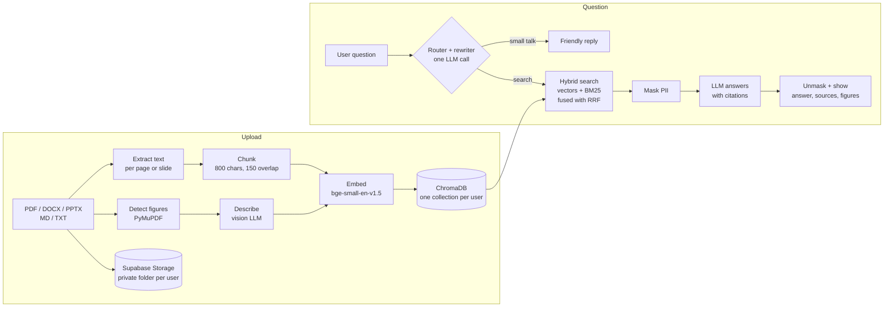

# 🔎 Personal Assistant: chat with your own documents

A retrieval-augmented generation (RAG) assistant. Each user uploads their own PDFs, Word and PowerPoint files, notes and text files, then asks questions in a chat. Answers come **only from their documents**, with numbered citations to the exact file and page. It also finds and shows **figures and charts** from inside PDFs.

Everything runs on free, open-source models and free hosting tiers.

**Live demo:** https://YOUR-APP.streamlit.app  <!-- replace with your app's address -->

<!-- Add a screenshot or GIF here, e.g.  -->

---

## Features

**Documents**
- Upload PDF, Word (.docx), PowerPoint (.pptx), Markdown and text files to a **private library**: other users can't see or search them.
- Figures inside PDFs, Word and PowerPoint files (charts, diagrams, photos) are detected, cropped, described by a vision model and made searchable. Ask "show me Figure 3" or "show me the chart about costs" and the figure appears under the answer.
- Attach files in the chat (📎) for one conversation only, without saving them.
- Per-user limits: 20 documents, 20 MB per file, 10 figures read per PDF.

**Answers**
- Every claim is cited as `[1]`, `[2]`… The **Sources** panel shows each passage, its page, and whether it was cited.
- If the documents don't contain the answer, it says so instead of guessing.
- Small talk ("hi", "thanks") gets a normal reply without searching the documents.
- Adjustable **Top K** (how many passages are retrieved per answer), saved per user.

**Quality measurement**
- 👍 / 👎 under every answer. The counts are kept permanently; the rated answers can be reviewed until you log out.
- A **📊 Evaluation** page:
  - build a test set by hand, auto-generate it from your documents, or turn 👎 answers into test cases;
  - compare four search methods side by side: keyword only, vector only, hybrid, and hybrid + query rewriting;
  - see hit rate @K, MRR and (optionally) citation accuracy and correct "not found" answers.

**Privacy and accounts**
- Email/password accounts (Supabase Auth). Login and the current conversation survive a page refresh.
- **Forgot password** with a one-time code sent by email.
- **Delete my account**: removes the user's files, figures, chats, search index and login in one step. A security-definer database function lets users delete only their own account, so the app never needs Supabase's secret key.
- **PII masking:** emails, phone numbers, card numbers, SSN/SIN and IP addresses are replaced with placeholders like `<EMAIL_1>` before any text reaches the LLM, and restored in the answer the user sees.
- Storage access is enforced **by the database itself** (row-level security), not only by the app's code.

---

## How it works



### Retrieval pipeline
1. **Routing and query rewriting.** One LLM call decides whether the message needs the documents, and rewrites it into 2–3 search queries:
   - a standalone version that resolves follow-ups like "and what about the second one?";
   - a keyword-only version;
   - for figure requests, a description of what the figure would show.
2. **Hybrid search.** Each query runs through:
   - **semantic search** (BGE embeddings in ChromaDB), which matches meaning;
   - **BM25 keyword search**, which matches exact terms, acronyms and numbers.

   The ranked lists are merged with **Reciprocal Rank Fusion**.
3. **Figure lookup.** "Figure 3" or "Table 2" is matched directly against figure captions. "Show me the … chart" makes sure the best-matching figure is included.
4. **Grounded answer.** The top K passages go to the LLM with instructions to answer only from them and to cite each claim. Invalid citations are flagged.

### Evaluation
A test case is a question plus a short phrase that the correct passage must contain. For questions the documents can't answer, the correct behaviour is "I couldn't find this".

| Metric | Meaning |
|---|---|
| **Hit rate @K** | Share of questions where a correct passage is in the top K retrieved |
| **MRR** (Mean Reciprocal Rank) | 1 if the correct passage ranks first, ½ if second, ⅓ if third… averaged. Rewards ranking it *high*, not just somewhere in the top K |
| **Cited correctly** | The generated answer cites at least one correct passage |
| **Correct "not found"** | For unanswerable questions, the answer says so instead of making something up |

Runs made during one login are charted together, so the effect of a change (Top K, rewording a question) shows up as a line on the "hit rate over time" chart. Test questions and results are cleared at log out; only the 👍/👎 counts are stored permanently. Test questions generated by the LLM are checked: the evidence phrase must appear word for word in the source passage, and reference-list chunks are skipped. Generated questions are still easier than real ones, so hand-written and 👎-derived cases matter most.

### Figure extraction
PDF figures are often vector drawings, not embedded images, so pulling out image objects isn't enough. Instead:
- figure regions are found from both images and drawing clusters;
- nearby small-font labels are merged in, and the "Figure N:" caption is attached;
- line-only tables and full-page scans are skipped;
- each region is rendered at 150 dpi.

A vision model writes a searchable description of each figure. The descriptions are stored with the images, so after a server restart figures are restored **without calling the vision model again**.

### Why these choices
| Choice | Reason |
|---|---|
| `BAAI/bge-small-en-v1.5` | Small enough for free CPU hosting (384-dim, ~130 MB), much better than MiniLM at paraphrased and technical questions. Loaded once, cached locally. |
| Hybrid search + RRF | Embeddings miss exact terms (model names, acronyms, numbers); BM25 misses paraphrases. Fusing ranks needs no score calibration. |
| Query rewriting | Makes follow-up questions work and adds keyword variants, with no extra LLM call (it shares the router's call). |
| One collection per user | Isolation by construction: a search physically can't return another user's chunks. |
| Supabase Storage as source of truth | Streamlit Cloud's disk is wiped on restart. Each user's index is rebuilt from their stored files on first login. |
| Reversible PII masking | Third-party LLM APIs never see personal details, but users still get complete answers. |

---

## Tech stack

| Part | Tool |
|---|---|
| UI and hosting | Streamlit, Streamlit Community Cloud |
| LLM | `openai/gpt-oss-20b` on Groq (or any Ollama model locally) |
| Vision model | `qwen/qwen3.8-27b` on Groq (or `qwen2.5vl:3b` on Ollama) |
| Embeddings | `BAAI/bge-small-en-v1.5` (sentence-transformers) |
| Vector database | ChromaDB |
| Keyword search | BM25 (implemented in `knowledge_base.py`) |
| Document parsing | pypdf (PDF text), PyMuPDF (PDF figures), python-docx, python-pptx |
| Auth and file storage | Supabase (free tier) |

---

## Project structure

| File | What it does |
|---|---|
| `chatapp.py` | The Streamlit app: login gate, "My documents" sidebar, chat, sources and figures |
| `knowledge_base.py` | Per-user `Library`: storage, indexing, hybrid search, settings, saved chat, feedback, limits |
| `evaluation.py` | Test cases, hit rate / MRR / citation checks, question generation |
| `eval_page.py` | The 📊 Evaluation page |
| `router.py` | Small-talk detection, LLM routing and query rewriting |
| `extractors.py` | Word and PowerPoint: text, tables, speaker notes, page/slide numbers, embedded pictures |
| `images.py` | Figure detection, cropping, captions, descriptions, restore |
| `embedder.py` | Loads the BGE embedding model and embeds passages and queries |
| `privacy.py` | Reversible PII masking (`Masker`) |
| `auth.py` | Supabase or local login, staying logged in after refresh, display names |
| `answer.py` | System prompt, Ollama settings, citation checking |
| `vector_store.py`, `step*.py` | Text extraction and chunking (from the step-by-step build) |
| `SETUP_SUPABASE.md` | One-time Supabase setup, including the storage security rules |

---

## Run it yourself

### Locally (no accounts needed)
```bash
git clone https://github.com/YOUR-USERNAME/rag_assistant.git
cd rag_assistant
python -m venv .venv && source .venv/bin/activate
pip install -r requirements.txt
```
Choose an LLM:
- **Groq (free, fast):** get a key at https://console.groq.com and create `.streamlit/secrets.toml`:
  ```toml
  GROQ_API_KEY = "gsk_..."
  ```
- **Fully offline:** install [Ollama](https://ollama.com), then `ollama pull llama3.1:8b`, plus `ollama pull qwen2.5vl:3b` for figures.

```bash
streamlit run chatapp.py
```
Without Supabase keys the app runs in **local mode**: accounts and files are stored in `user_data/` on your computer.

### Online (Streamlit Community Cloud)
1. Follow [`SETUP_SUPABASE.md`](SETUP_SUPABASE.md) to create the bucket and its security rules.
2. Deploy the repo on https://share.streamlit.io with `chatapp.py` as the main file.
3. In **Settings → Secrets** add:
   ```toml
   GROQ_API_KEY = "gsk_..."
   SUPABASE_URL = "https://xxxx.supabase.co"
   SUPABASE_KEY = "sb_publishable_..."   # publishable/anon key, never the service_role key
   ```

> Keep `.streamlit/secrets.toml` in `.gitignore`. Keys belong only in Streamlit Secrets.

---

## Results

On a test set of 14 questions about a research paper, written in different words from the paper, the retrieval upgrades (BGE embeddings, hybrid search, query rewriting) raised the number of questions where the right passage was retrieved from **8 to 12**. Figure extraction on the same paper found exactly its five figures, each with the correct caption.

---

## Limitations and next steps
- Scanned (image-only) PDFs have no extractable text yet. Next step: OCR.
- The free Groq tier limits vision output per minute, so figure-heavy PDFs upload slowly. The app waits and retries automatically.
- Planned:
  - multiple saved chats;
  - "ask only this document".

---

Built by **Tanzila Himu** as a hands-on project to learn retrieval-augmented generation end to end.
